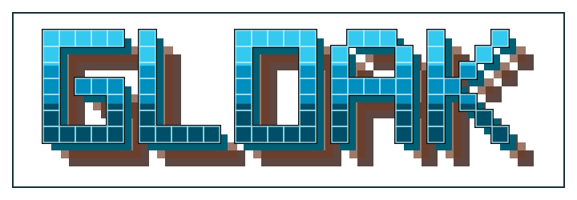

# gloak

<p align="center">
  
</p>


> Go single-binary CLI for age-encrypted, chunked, verified backups.

> [!WARNING]
> gloak is alpha software (`v0.1.0-alpha.1`). Do not use it as your only backup path.
> The storage layout, manifest format, CLI flags, and restore behavior may change without compatibility guarantees.
>
> Use it for testing, non-critical data, or secondary backups only. If you store anything important with gloak, keep another verified backup somewhere else.

gloak splits one file into fixed-size chunks, encrypts each chunk with age, uploads them, and verifies every chunk before restore. Metadata such as filenames, sizes, recipients, and hashes lives inside an age-encrypted manifest. Storage only sees backup IDs, public completion markers, and encrypted chunk objects.

```text
keygen -> chunk -> encrypt chunks -> upload -> verify -> restore
```

Full usage guide: [docs/WORKFLOW.md](docs/WORKFLOW.md)

---

## Quick start

```bash
# install dependencies
go mod download

# build standalone binary
go build -o gloak .

# generate keys
./gloak keygen

# upload
./gloak upload ./secret.tar --remote myremote:backup_folder

# verify
./gloak verify <backup-id> --remote myremote:backup_folder -i ~/.gloak/identity.txt

# restore
./gloak restore <backup-id> --remote myremote:backup_folder --output-dir ./restored/
```

Need rclone? Run:

```bash
./gloak setup
```

---

## What it does

- Encrypts each chunk independently with age.
- Stores backup metadata in an encrypted `manifest.age`.
- Uploads `locator.json` last, so incomplete backups do not look complete.
- Verifies encrypted and plaintext chunk hashes before restore.

---

## Why this exists

Most backup tools make at least one tradeoff gloak avoids:

1. Encrypt a single blob. If a network failure hits at byte 47 GB of 50, retrying is painful.
2. Split into chunks without enough integrity metadata. You find corruption during restore, without a manifest to guide repair.
3. Store metadata in plaintext. Filenames, sizes, recipient keys, and chunk hashes are visible to anyone who can read the storage.
4. Pull in rclone, restic rest-server, or S3 libraries when you just need local filesystem or a mounted remote.

gloak keeps the design narrow: age encryption, fixed-size chunks, chunk and payload hashes, and an encrypted manifest so the storage backend does not see filenames or hashes.

---

## Commands

| Command | Purpose |
|---------|---------|
| `gloak setup` | Download a standalone rclone binary to `~/.gloak/bin`. |
| `gloak keygen` | Generate `identity.txt` and `recipient.txt`. |
| `gloak upload <file> --remote <remote>` | Encrypt, chunk, and upload a backup. |
| `gloak verify <backup-id> --remote <remote>` | Verify manifest, encrypted chunks, plaintext chunks, and payload hash. |
| `gloak restore <backup-id> --remote <remote>` | Restore a verified backup to an output directory. |

For command options, examples, storage layout, and troubleshooting, read [docs/WORKFLOW.md](docs/WORKFLOW.md).

---

## Storage shape

An upload (`gloak upload`) writes one folder per backup:

```text
/mnt/backups/
  {backup_id}/
    locator.json
    manifest.age
    chunk_00000
    chunk_00001
    chunk_00002
```

`locator.json` is public and contains only the format version and backup ID. `manifest.age` is encrypted and contains the original filename, size, creation time, the master key, the payload hash, and per-chunk hashes.

A repository (`gloak init` and `gloak backup`) keeps a content-addressed layout instead:

```text
/mnt/backups/
  repo.json
  keys/{fingerprint}.age
  data/{ab}/{sha256}
  snapshots/{uuid}.age
  index/000001.age
```

`repo.json` is the public completion marker with the format version, creation time, recipient keys, and chunk size parameters. Each recipient gets one wrapped master key under `keys/`. Encrypted chunks live under `data/`, keyed by the plaintext hash of each chunk. Snapshot manifests are encrypted under `snapshots/`, and checkpoint files under `index/` record which chunks already exist so a re-run skips them.

---

## Not built yet

| Feature | Reasoning |
|---------|-----------|
| Named storage profiles | `--remote my-backups` instead of typing URIs. |
| Telegram integration | Hermes Agent plugin for backup/restore/verify via Telegram. |
| Per-chunk data keys | Each chunk would use its own data key stored inside the encrypted manifest. This would limit key exposure if a key leaks. |

---

## License

MIT
